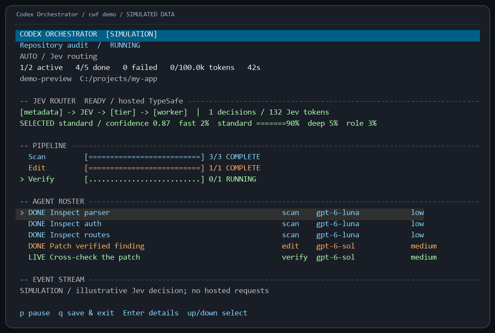

<div align="center">

# Codex Orchestrator

### One prompt. A control room for the work behind it.

**Talk to Codex. Route the work. Watch the agents. Verify the patch.**

[](package.json)
[](https://github.com/chittranshsharma/Codex-Orchestrator/actions/workflows/release.yml)
[](https://nodejs.org/)
[](LICENSE)


<sub>The real terminal renderer with simulated data. No model calls were made for this preview.</sub>

[Get started](#get-started) · [Jev](#optional-jev-routing) · [Full reference](docs/reference.md) · [Verification evidence](VERIFICATION.md)

</div>

Your coding session deserves more than a wall of logs. Codex Orchestrator puts the plan, workers, models, checks, and progress in one terminal view. Give it a task, follow up in the same conversation, and switch orchestration on whenever the work needs extra hands.

The script carries the coordination. Focused agents do the work. Edits land in isolated Git worktrees, and a separate verifier checks a patch before it becomes eligible to apply. Every run leaves evidence you can inspect: source, results, reported usage, decisions, and diffs.

It is a small control room for a serious coding session.

## The useful parts

| Capability | What you get |
| --- | --- |
| Normal conversation | Prompts and follow-ups; fresh chat by default |
| Orchestration switch | `/orchestrate on` or `off` within the current conversation |
| Automatic routing | Local role and complexity policy, with no extra routing model call |
| Your model choices | Explicit task or role assignments override automatic routing |
| Premium warnings | A notice before Astra or Sol 6.1 is used |
| Token awareness | Lighter default profiles, bounded workers, reported usage and scheduling limits |
| Verified patches | Isolated edits, independent checks, explicit application |
| Visible execution | Live activity, phases, agent details, Jev state and reports |
| Optional continuity | Resume a saved chat or run only when you choose |
| Codex app skill | Say “use orchestrator” after installing the skill |

## Get started

You need Node.js 22+, Git, and a working Codex login with access to your chosen models.

```sh
npm install -g https://github.com/chittranshsharma/Codex-Orchestrator/releases/download/v0.6.0/codex-workflow-0.6.0.tgz
cd your-project
cwf
```

```text
> Explain the authentication flow.
> Where could session expiry go wrong?
> /orchestrate on
> Investigate that bug and prepare an independently verified fix.
> /orchestrate off
> Explain what changed.
```

New chats start with orchestration OFF and automatic worker routing ready. `/agents manual` enables per-job selection. `/model MODEL EFFORT` sets the lead. `/usage` shows reported usage; `/new` starts fresh. `codex` remains available separately. OFF edits the current checkout; ON reviews the workflow before launching isolated jobs.

For Codex app integration, run `cwf install-skill` once (`--update` for an existing installation), reload skills or open a new chat if needed, then ask:

> Use orchestrator to investigate this bug. Use Luna for scans and Sol 6 for verification.

The skill runs the workflow from the current app conversation. The terminal dashboard is available through `cwf watch RUN_ID`; it is not embedded into the app's native chat interface.

## Optional Jev routing

Jev adds typed routing judgments from TypeSafe's hosted service. It is **off by default**; local routing works without it.

```sh
cwf jev setup
```

That prints the global `jev.env` location. Add `TYPESAFE_API_KEY=your_key` there locally. You can also pass an existing file with `cwf --env-file /private/jev.env`. In chat, `/jev on` enables it for Auto workflows. `cwf jev status` shows setup status; `cwf jev probe` tests connectivity with synthetic metadata.



<sub>Real renderer, simulated decisions. Confidence and token values are illustrative.</sub>

Default Jev requests contain task metadata: role, prompt length, output/workspace flags, and a local complexity flag. Task text and code are excluded. `--jev-task-text` is a separate opt-in to sharing task text and semantic decision state. Equivalent judgments reuse a cache; unavailable service calls fall back to local profiles. Credentials stay out of saved run config and worker environments.

Hosted routing is a tradeoff. Metadata may be too limited to help; probabilities do not prove correctness. Live routing quality and net token savings need evaluation on your workload. Keep Jev off if that tradeoff is not useful to you.

## Keep the work focused

New defaults use Luna for planning/scans/review and Sol 6 for edits and verification. They avoid Astra and Sol 6.1 unless selected. Two workers run at once, with a 16-job cap, no automatic request retries, and a default scheduling limit of 100000 reported Codex tokens. Worker skill catalogs and tool history are bounded. The audit assembles its summary in code and bounds repair attempts, avoiding an extra summary model call.

`--token-budget N` changes that limit. It stops new calls after reported usage reaches N; in-flight calls and unreported usage can exceed it. A smaller model does not necessarily use fewer tokens. Orchestration can use more tokens than a direct turn, especially when independent verification adds work. There is no honest universal savings guarantee.

Need the full command surface, custom workflows, model maps, patch application, or recovery details? They live in the [reference](docs/reference.md), so this page can stay readable.

Independent community project built on the official Codex SDK. Trusted workflow scripts run as local JavaScript. [MIT licensed](LICENSE).
