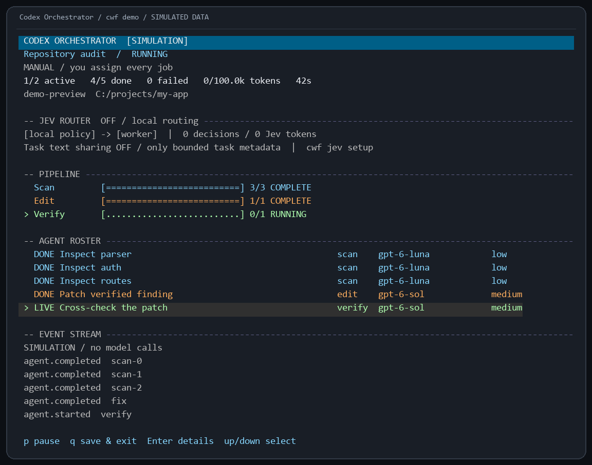
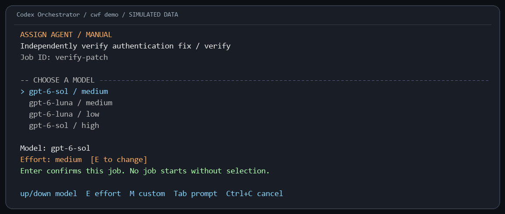
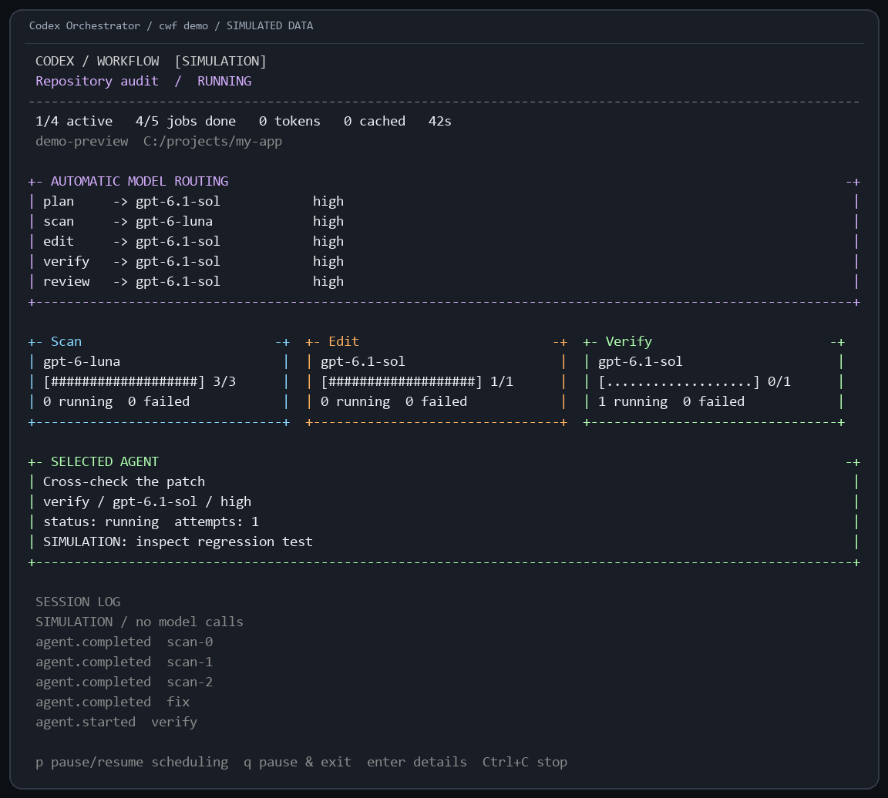

<div align="center">

# Codex Orchestrator

### Give your coding agents a control room.

Script the mission. Route the models. Run the agents. Verify the patch.

[](package.json)
[](https://nodejs.org/)
[](LICENSE)
[](https://learn.chatgpt.com/docs/codex-sdk)

**A terminal control plane for scripted Codex workflows, parallel agents, Jev routing, and independently verified edits.**



<sub>Actual dashboard renderer with simulated jobs and zero model calls. Try it with <code>cwf demo</code>.</sub>

[Quick start](#quick-start) · [Jev routing](#give-the-router-a-brain) · [Write workflows](#workflows-are-code) · [Full reference](docs/reference.md)

</div>

## The idea

Your lead model sets the plan. A saved JavaScript workflow handles execution: fan out inspections, assign bounded jobs to appropriate models, prepare edits in Git worktrees, and bring in independent verifiers. Intermediate results live in checkpoints rather than needing to be pasted back into one conversation.

You get a terminal view of the operation: phases, active agents, assigned models, job details, events, and reported Codex token usage. Every run leaves a script and report you can inspect and reuse.

Think mission control for your repository. The machinery is ordinary, readable code.

| Capability | What it does |
| --- | --- |
| Parallel workers | Fan out jobs with bounded concurrency and a total job cap |
| Model routing | Assign models and effort by role, or enable Jev decisions per task |
| Isolated edits | Give editors dedicated worktrees; keep your checkout untouched until apply |
| Independent verification | Require a separate passing verifier before accepting an edit patch |
| Durable runs | Save scripts, inputs, outputs, decisions, events, and patches |
| Resume | Replay matching checkpoints and rerun unfinished work plus downstream jobs |
| Workflow authoring | Turn a natural language task into a script for review |
| Terminal + Codex | Use the same runner from a terminal or a Codex skill |

```text
Task → saved workflow → parallel scans → isolated edits → verification → report
                             ↑                 ↑
                       Jev model routing   explicit patch apply
```

## Quick start

Requirements: **Node.js 22+**, **Git**, and Codex authentication with access to your chosen models. Install and sign in to [Codex CLI](https://developers.openai.com/codex/cli/) first if needed. The SDK bundles its worker runtime and uses existing authentication. A working ChatGPT login can be used; account limits apply.

Install the compiled public release directly:

```sh
npm install -g https://github.com/chittranshsharma/Codex-Orchestrator/releases/download/v0.4.0/codex-workflow-0.4.0.tgz
cwf doctor
cd /path/to/your/project
cwf
```

You are now in the **real task launcher**:

1. Describe your task, such as "Find and fix the bug that keeps expired sessions logged in."
2. Choose **Manual** or **Auto**. Manual asks for the model and effort before each job, including planning.
3. The planner writes a workflow. Read the displayed source and type **RUN** to launch it, or press Enter to save it for later.
4. Watch the agents work, then read the printed result and saved report.
5. If edits were prepared, review their patches and explicitly apply an independently verified edit.

You can supply the prompt immediately:

```sh
cwf start "Find and fix the expired-session bug" --manual
```

The launcher makes real Codex calls and uses your account limits. It is a task/workflow launcher, not an interactive chat replacement. For follow-up conversation and everyday tasks, keep using `codex`. Nothing wraps or intercepts it.

| You want to… | Type |
| --- | --- |
| Use normal Codex | `codex` |
| Prompt a coordinated task | `cwf` or `cwf start "your task"` |
| Run the built-in audit | `cwf run audit --target src --manual` |
| Preview the UI without model calls | `cwf demo` (optional) |

`cwf`, `codex-orchestrator`, and `codex-workflow` launch the same program. The internal npm package name is `codex-workflow`. The GitHub release is public; an npm registry publication is separate and is not required for this installation.

For custom defaults, run `cwf init`, review `.codex-workflow.json`, and commit it. Edits require a clean source checkout. Choose models available to your account.

<details>
<summary>Build and install from source instead</summary>

```sh
git clone https://github.com/chittranshsharma/Codex-Orchestrator.git
cd Codex-Orchestrator
npm ci
npm run build
npm link
```

</details>

You can also run prepared workflows directly:

```sh
# Inspect code and independently verify findings.
cwf run audit --target src

# Focus the review.
cwf run audit --target src --question "Find missing authorization checks"

# Prepare isolated fixes and independently verify them.
cwf run audit --target src --fix
```

The dashboard opens in an interactive terminal. Use `--plain` inside command tools or `--json` for event consumers. `doctor` makes no model calls; `doctor --live` makes short, metered probes of configured Codex models.

### You choose who runs each job

New runs default to **Manual**. In an interactive terminal, a run without a mode flag first asks you to choose Manual or Auto. Manual opens a picker before each job starts: choose a model, change reasoning effort, inspect the full prompt, or enter a custom model ID. Downstream jobs are offered when earlier findings make them known. Other already approved jobs can run in parallel.

```sh
cwf run audit --target src --manual
cwf run audit --target src --auto
cwf run audit --target src --auto --jev
cwf demo --manual
```



Use Up/Down to choose, **E** to cycle effort, **M** for a custom model, **Tab** to inspect the prompt, and **Enter** to confirm. Custom model entry takes Enter to finish typing, then another Enter to confirm. Ctrl+C cancels. Manual mode makes no Jev calls and uses explicit fallbacks for semantic workflow decisions. Saved job selections are reused on resume; a changed downstream prompt requires a new selection.

For scripts, plain output, or Codex command tools, pass an exact job map with `--manual --agents-file agents.json`:

```json
{
  "scan-0": { "model": "gpt-6-luna", "effort": "high" },
  "finding-0": { "model": "gpt-6.1-sol", "effort": "high" },
  "review": { "model": "gpt-6.1-sol", "effort": "high" }
}
```

This is an example, not an exhaustive map for every audit. Job IDs depend on findings and fix rounds. A missing assignment stops that job with a visible error; no model is silently selected. Use `--auto` only when you want automatic assignment. Older saved runs retain their original routing behavior.

### Review, then apply

The runner prints a run ID and report path. Inspect the report and captured patch, then apply an accepted edit:

```sh
cwf show RUN_ID
cwf apply RUN_ID --task EDIT_JOB_ID
git diff
```

Use the edit job ID listed in the report. Application checks the original commit, patch integrity, verifier result, and conflicts. Run your project's integration checks before committing. Commits, pushes, and deployments are explicit actions.

## Give the router a brain

Optional **TypeSafe Jev** routing judges the task before each worker starts. Code maps its decision to a model and reasoning effort profile.

| Tier | Default model | Effort |
| --- | --- | --- |
| Fast | `gpt-6-luna` | `high` |
| Standard | `gpt-6.1-sol` | `high` |
| Deep | `gpt-6.1-sol` | `xhigh` |

These are configurable starting profiles and require account access. Without Jev, scans use the scan role profile and other jobs use their configured roles. With Jev, planning, verification, and final review have a standard tier floor.

```powershell
# PowerShell: set the key locally, then enable routing.
$env:TYPESAFE_API_KEY = '<your TypeSafe key>'
cwf run audit --target src --auto --jev
```

```sh
# macOS / Linux shell
export TYPESAFE_API_KEY='<your TypeSafe key>'
cwf run audit --target src --auto --jev
```

For semantic target selection as well as model routing:

```sh
cwf run jev-review --target src/auth --target src/api --question "Find session expiry bugs" --auto --jev
```

Set `jev.enabled` in `.codex-workflow.json` for the repository default. Customize `jev.profiles`, `jev.confidence`, and `jev.timeoutMs` there. `--no-jev` disables it for a new run. Role model overrides are fallbacks; dynamic tier models come from `jev.profiles`.

Jev receives job prompts, roles, labels, and explicitly supplied decision state through TypeSafe's hosted API. Keep the key in your environment. Missing keys, low confidence, timeouts, and service errors visibly use the configured fallback. Saved decisions include probabilities, resolved model, confidence, and separate Jev usage. Resume reuses identical saved decisions, including fallbacks.

Jev works alongside Codex and cannot satisfy the independent patch verification gate. The initial confidence threshold is a policy starting point; live routing quality and token savings have not been measured.

## Inside the control room



*Actual selected-agent renderer with simulated data.*

| Key | Action |
| --- | --- |
| ↑ / ↓ | Select an agent |
| Enter | Toggle agent details |
| P | Pause or resume scheduling; active jobs finish |
| Q / Ctrl+C | Abort active requests and save for resume |

```sh
cwf list
cwf watch RUN_ID
cwf show RUN_ID --json
cwf resume RUN_ID
```

`watch` is a separate viewer. Resume uses the original script, inputs, and configuration. Completed matching jobs before the first unsuccessful job are reused; that job and downstream jobs rerun to prevent stale summaries. Source repository or saved workflow changes block resume.

## Workflows are code

Ask Codex to draft one:

```sh
cwf plan "Review each API route for authorization bugs and verify every finding" --out auth-audit.mjs
# Read auth-audit.mjs before executing it.
cwf run ./auth-audit.mjs
```

Or write it yourself:

```javascript
export const meta = {
  name: 'review-areas',
  description: 'Inspect code areas in parallel, then independently verify findings',
};

export default async function ({ args, phase, agent, pipeline }) {
  phase('Scan');
  const findings = await pipeline(args.targets ?? ['src'], (target, index) =>
    agent(`Inspect ${JSON.stringify(target)} for correctness bugs. Cite evidence.`, {
      id: `scan-${index}`, role: 'scan', label: target,
    }),
  );
  phase('Verify');
  return agent(`Independently check these findings against the code.
Preserve failed or missing checks explicitly: ${JSON.stringify(findings)}`, {
    id: 'verify', role: 'verify',
  });
}
```

Pass JSON inputs with `--args-file inputs.json`. Save a run's exact source using `cwf save RUN_ID --out reusable.mjs`.

The API provides `agent`, `pipeline`, `parallel`, `phase`, `log`, `repeat`, `acceptPatch`, and `decide`. `decide(state, { id, instructions, choices, fallback })` lets Jev guide bounded branches such as target selection or retry/split/stop choices. The script implements those branches. Use stable, unique IDs; `route-` decision IDs are reserved. See the [full reference](docs/reference.md#workflow-api) and [bundled workflows](workflows).

Generated scripts are saved after syntax checking and require review. They are trusted Node.js programs with your operating system permissions, not a secure sandbox.

## Use it inside Codex

```sh
cwf install-skill
```

Start a new Codex chat, then ask:

> Use $codex-workflow to audit src for authorization bugs and prepare verified fixes.

The skill invokes the same runner with plain progress and reads the report. Use a terminal for the interactive dashboard. This adds a skill, not a native workflow screen in the Codex app.

## Defaults and practical limits

Four concurrent workers, 100 jobs per run, 15 minutes per job, and one transient retry for read jobs. Edit jobs are not automatically retried. Configure limits in `.codex-workflow.json`. Token telemetry is informational, not a spending cap.

Workers inherit applicable Codex configuration and integrations. Worktrees isolate edits but share Git metadata and machine resources. Ignored dependencies and environment files are not copied. Individually verified patches still need combined integration checks.

No detached daemon, automatic subscription reset wait, or complete process recovery after a crash is implemented. The automated suite passes on Windows, macOS, and Linux; real model pilots have been run on Windows. State defaults to `%LOCALAPPDATA%/CodexWorkflow` on Windows or `$XDG_STATE_HOME/codex-workflow` / `~/.local/state/codex-workflow` elsewhere; override with `--state-dir` or `CWF_STATE_DIR`.

## Development and evidence

```sh
npm ci
npm test
npm run build
```

Tests cover concurrency, routing, replay, failure handling, cancellation, real Git worktrees, patch gates, conflicts, CLI validation, terminal bounds, and Jev contracts/fallbacks. A live Codex pilot reproduced a seeded bug, prepared an isolated fix, independently verified it, and explicitly applied it. Another pilot generated and executed a workflow.

See [verification notes and recorded evidence](VERIFICATION.md). Jev tests use controlled responses; live Jev inference and performance improvements remain unverified. Dashboard images use simulated data.

Contributions are welcome. Keep changes focused, include checks for behavioral changes, and document new configuration.

## Credits and license

Inspired by scripted coding-agent workflows and [Claude Code workflow patterns](https://code.claude.com/docs/en/workflows). Built with the [official Codex SDK](https://learn.chatgpt.com/docs/codex-sdk), with optional decisions through [TypeSafe Jev](https://docs.typesafe.ai/).

An independent community project, unaffiliated with OpenAI, Anthropic, or TypeSafe. [MIT](LICENSE).
